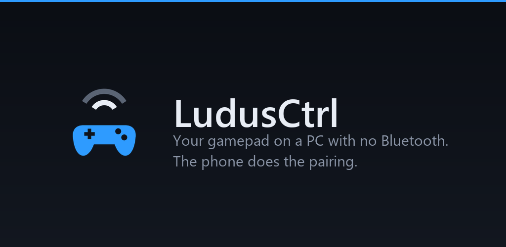
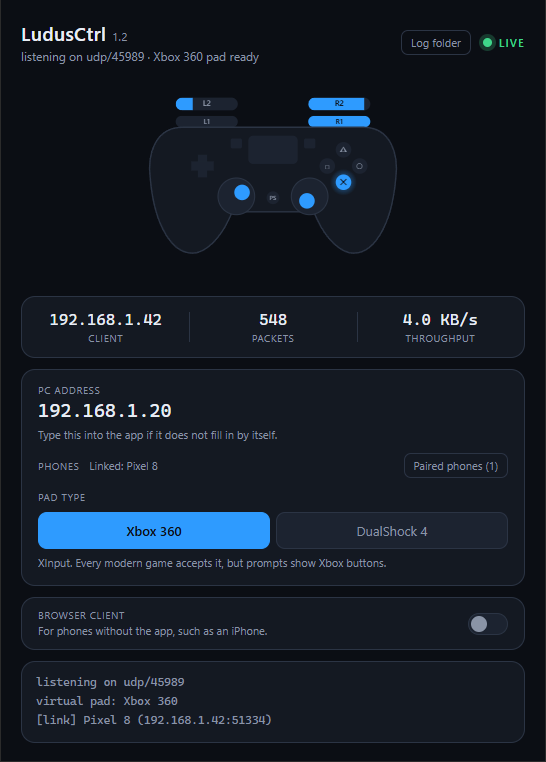
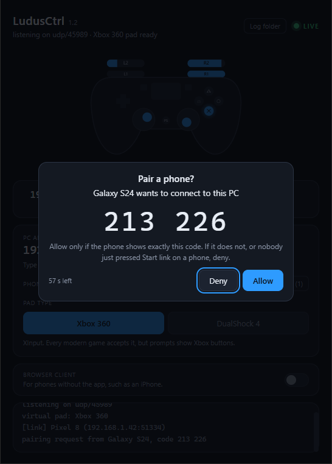
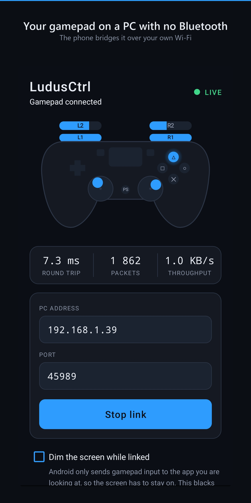

<p align="center">
  
</p>

# LudusCtrl receiver

[](https://github.com/parl0v/ludusctrl/actions/workflows/ci.yml)

The Windows half of [LudusCtrl](https://parl0v.github.io/ludusctrl/): use a
DualSense, or any Bluetooth gamepad, on a PC that has **no Bluetooth radio**,
by borrowing the Bluetooth of a phone that does.

```
DualSense  ──Bluetooth──▶  phone  ──Wi-Fi──▶  this receiver  ──▶  ViGEmBus virtual pad
                                                                         │
                                                Windows sees an Xbox 360 or DualShock 4 pad
```

About **5 KB/s** on the wire. No video, no audio, no desktop streaming, just
the pad. The display stays on plain HDMI.

<p align="center">
  
  
  
</p>
<p align="center"><sub>The receiver mirroring a linked phone · pairing a new phone · the Android app</sub></p>

The phone side is either the **LudusCtrl Android app** (Google Play, in closed
testing) or **any phone's web browser**, iPhones included, through the browser
client this receiver serves. This repository is the receiver only; the Android
app is not published as source.

- [Download](#install)
- [Using it](#using-it)
- [Security model](#security-model)
- [Run from source](#run-from-source) · [Build](#build-the-executable-and-the-installer) · [Tests](#tests)
- [Wire protocol](docs/PROTOCOL.md)

---

## Why not Moonlight and Sunshine

Sunshine can already carry a gamepad, but only as a side effect of streaming
the whole desktop. Its input channel is tied to the video and audio channels by
the RTSP handshake, and Moonlight ends the session if no video frames arrive,
so there is no supported way to ask for input alone. That is 10–50 Mbps of
encoded video to carry 5 KB/s of joystick.

This does the joystick and nothing else. No Sunshine or Moonlight code is used;
it is an independent protocol and implementation.

---

## Features

- **Xbox 360 or DualShock 4.** Every XInput game accepts the Xbox 360 pad with
  no setup. The DualShock 4 target uses Sony's hardware id, so games show
  PlayStation prompts.
- **Paired, signed input.** A phone pairs with the PC once by confirming a
  6-digit code on both screens. After that every packet is authenticated, so
  nothing else on the network can drive the pad or replay a recording.
- **Browser client.** Phones without the app open a page served by the receiver
  over HTTPS and forward the pad from the browser's Gamepad API.
- **Live mirror.** The desktop window draws the controller exactly as the phone
  sees it, at display rate, with the link status, packet rate and round trip.
- **Safe by default.** A watchdog releases every input after 1.5 s of silence,
  one phone drives the pad at a time, and the virtual pad is torn down cleanly
  so no phantom controller is left behind.
- **One installer.** Receiver, ViGEmBus driver and firewall rules in one setup
  file.

---

## Requirements

| Side | Needs |
| --- | --- |
| PC | Windows 10 or 11, x64. The installer brings the receiver, the [ViGEmBus](https://github.com/nefarius/ViGEmBus) driver and the firewall rules. The window uses the Microsoft Edge WebView2 Runtime, which Windows 11 always has; the installer tells you if yours does not. |
| Phone, app | Android 7.0+ with Bluetooth and LudusCtrl 1.2 or newer. Android 12+ maps the DualSense natively. |
| Phone, browser | Any phone whose browser exposes the Gamepad API on HTTPS pages: iOS Safari, Chrome, Firefox. |

Both devices must be on the same network.

**Version pairing:** receiver 1.2 talks only to app 1.2 and newer. App 1.1 sees
`NO REPLY` from it, and app 1.2 shows "is the PC app updated to 1.2?" against
an older receiver. Update both together.

---

## Install

Download `LudusCtrl-<version>-setup.exe` from the
[latest release](https://github.com/parl0v/ludusctrl/releases/latest) and
check its SHA-256 against the one in the release notes. Each release is built
from the tagged commit in this repository. The installer:

- puts the receiver under Program Files, with Start menu shortcuts for
  **LudusCtrl** and **LudusCtrl (phone browser mode)**;
- installs or updates **ViGEmBus**, a kernel-mode driver by Nefarius Software
  Solutions (BSD-3-Clause), unless you untick it. Without it the receiver
  cannot create a controller;
- adds Windows Firewall rules for the receiver only, on private networks only,
  from your local subnet only (see [Firewall](#firewall));
- checks for the WebView2 Runtime and links Microsoft's download if it is
  missing.

Uninstalling removes the app and its firewall rules but **leaves ViGEmBus
installed**, because other programs (DS4Windows and the like) use the same
driver. Remove "ViGEm Bus Driver" in Settings > Apps if you want it gone too.

The installer is not code-signed yet, so SmartScreen warns on the download.

---

## Using it

### With the Android app

1. Pair the controller with the phone over Bluetooth. For a DualSense, hold
   **Create + PS** until the light bar double-flashes, then pair
   "Wireless Controller" in the phone's Bluetooth settings.
2. Start **LudusCtrl** on the PC.
3. Open the app on the phone. The PC's address fills itself in within about
   two seconds. Press **Start link**.
4. **First time only:** the PC asks *"Pair a phone?"* and shows a 6-digit
   code. Click **Allow** only if the phone shows the same code. If it does not,
   or nobody just pressed Start link, click **Deny**.
5. The badge on the phone reads `LIVE` once the PC is applying its input.
   Check the pad in Windows with `joy.cpl` or <https://hardwaretester.com/gamepad>.

Keep the app in the foreground: Android stops delivering gamepad input to
background apps.

| Phone shows | Meaning |
| --- | --- |
| `LIVE` | the PC is applying this phone's input |
| `PC BUSY` | the PC answers, but another phone or the browser client holds the pad, or the virtual pad did not start |
| `NO REPLY` | nothing answers: check the receiver is running and the [firewall](#firewall) |
| `UPDATE NEEDED` | the receiver and the app speak different protocol versions |
| `PAIRING` | waiting for Allow on the PC |

Paired phones are listed in the PC window under **Paired phones**, each with
Remove. The terminal receiver lists them with `--phones` and removes them with
`--forget N` or `--forget all`.

### With a phone's browser

Turn the browser client on with the switch in the LudusCtrl window, the
**LudusCtrl (phone browser mode)** shortcut, or `--web`. It is off by default,
because it opens a second listener on your network.

1. The window shows an address such as `https://192.168.1.20:45991/#t=…`, and a
   QR code for it. Open it on the phone exactly as shown; the part after `#t=`
   is a random token, new every time the client starts, and a page without it
   cannot drive the pad.
2. The page is HTTPS because browsers only expose gamepads to secure pages. No
   certificate authority signs a private IP address, so the receiver makes a
   self-signed certificate on first use. The phone warns once; on iOS, tap
   *Show Details*, then *visit this website*.
3. Press a button on the pad. The page shows `LIVE` once the PC is applying it.

The browser client and the app take turns: whichever starts first holds the
pad, and the other is told the PC is busy.

### Xbox 360 or DualShock 4

| | Xbox 360 (default) | DualShock 4 |
| --- | --- | --- |
| API | XInput | HID |
| Game support | universal | most, but XInput-only titles see **nothing** |
| On-screen prompts | Xbox glyphs | PlayStation glyphs |
| Stick resolution | 16-bit | 8-bit, like a real DualShock 4 |

Switch it in the window, or with `--pad ds4`. Windows sees the DualShock 4
target as `VID_054C&PID_05C4`, which is what makes games switch to PlayStation
prompts. Xbox 360 stays the default because compatibility beats correct button
icons when a game cannot see the pad at all.

---

## Security model

The receiver turns network packets into a game controller, so it is built to
assume the local network is not friendly.

- **Pairing.** ECDH on P-256 with fresh keys per attempt. The phone commits to
  a random nonce before it sees the PC's key, and the 6-digit code covers that
  nonce, so an attacker in the middle cannot search for a matching code; they
  get one blind guess in a million per attempt. Pairing needs a click on the
  PC.
- **Every packet is signed.** Input and acks carry a truncated HMAC-SHA256
  under a per-phone 256-bit key, plus a session number and sequence number.
  Old sessions are refused, and the highest session is written to disk before
  a new one is accepted, so a recording cannot be replayed even across a
  restart.
- **Authenticated, not encrypted.** Someone on your network can see what the
  pad is doing; they cannot change it.
- **Browser client:** HTTPS, a per-start 128-bit token, an Origin check, and
  only the current driver can change the pad type.
- **Local only.** Packets from addresses outside private, link-local and
  loopback ranges are dropped, and the installer's firewall rules open the
  ports only on private networks and the local subnet. Do not run it on public
  Wi-Fi.
- **Pairings on disk** live in `%LOCALAPPDATA%\LudusCtrl\pairing.json`, written
  atomically and restricted to your Windows account.

The details, including every check the receiver makes and in what order, are
in [docs/PROTOCOL.md](docs/PROTOCOL.md). To report a vulnerability, see
[SECURITY.md](SECURITY.md).

---

## Firewall

The installer handles this. It removes any old rule for `LudusCtrl.exe`
(including the block rule Windows keeps if its "allow access" prompt was ever
cancelled) and adds two inbound allow rules, both limited to `LudusCtrl.exe`,
the **Private** profile and your **local subnet**:

| Rule | Port | Used by |
| --- | --- | --- |
| LudusCtrl controller input (UDP 45989) | UDP 45989 | the Android app, pairing included |
| LudusCtrl browser client (TCP 45991) | TCP 45991 | the browser client, only while it is on |

The discovery beacon (UDP 45990) is sent by the PC, so it needs no inbound
rule.

**If nothing arrives, check that Windows files your home network as
Private:** Settings > Network & Internet > (your connection) > Properties >
Network profile type > Private. New networks are often filed as Public.

Running from source, add the rules by hand from an administrator prompt,
pointing `program=` at your `python.exe` or `LudusCtrl.exe`:

```bat
netsh advfirewall firewall add rule name="LudusCtrl controller input (UDP 45989)" dir=in action=allow program="C:\Program Files\LudusCtrl\LudusCtrl.exe" protocol=UDP localport=45989 profile=private remoteip=localsubnet
netsh advfirewall firewall add rule name="LudusCtrl browser client (TCP 45991)" dir=in action=allow program="C:\Program Files\LudusCtrl\LudusCtrl.exe" protocol=TCP localport=45991 profile=private remoteip=localsubnet
```

---

## Run from source

Needs Python 3.9 or newer (releases are built with 3.13.7) and
[ViGEmBus](https://github.com/nefarius/ViGEmBus/releases) installed.

```bash
cd pc
python -m pip install -r requirements.txt
python install_vgamepad.py    # not `pip install vgamepad`, see below
python app.py                 # desktop app
python dualsense_link.py      # terminal receiver
```

`run.bat` installs and launches in one double-click; `run-web.bat` does the
same with the browser client on.

| Flag | Applies to | Effect |
| --- | --- | --- |
| `--port N` | both | UDP input and pairing port (default 45989) |
| `--beacon-port N` | both | discovery beacon port (default 45990) |
| `--no-beacon` | both | stop broadcasting; type the PC's address into the app instead |
| `--pad x360\|ds4` | both | which virtual controller to present |
| `--web` | desktop app | start with the browser client on |
| `--web-port N` | desktop app | browser client port (default 45991) |
| `--ui NAME` | desktop app | front end folder: `webui` (default) or `webui-instrument` |
| `-q` | terminal | hide the live input readout |
| `--phones` | terminal | list paired phones and exit |
| `--forget N\|all` | terminal | remove paired phone N, or all of them, and exit |

The terminal receiver asks about pairing on stdin: type `y` and Enter to allow.

Everything the receiver keeps is in `%LOCALAPPDATA%\LudusCtrl\`:
`settings.json`, `pairing.json`, `ludusctrl.log` (rotated at 1 MB, never sent
anywhere) and the browser client's `web-cert.pem` / `web-key.pem`. Set
`LUDUSCTRL_DATA_DIR` to move all of it, which is what the tests do.

### If `pip install vgamepad` hangs

It hangs for anyone who already has a current ViGEmBus, so use
`python install_vgamepad.py` instead.

vgamepad 0.1.0 detects the driver by searching the registry for the product
name ViGEmBus used before 1.19. Every release since registers under a new
name, so detection says "not installed" when it is, and `setup.py` runs
`msiexec` without `/quiet`. The MSI opens a Repair/Remove wizard and pip waits
behind it forever. `pip download` does not avoid it either, because modern pip
runs `setup.py` to prepare metadata.

`install_vgamepad.py` fetches the sdist from PyPI, checks it against a pinned
SHA-256, removes the `msiexec` call and installs the patched tree. It refuses
to run unless the ViGEmBus service is present and running, so it cannot be
used to skip a driver you actually need. That is also why vgamepad is not in
either requirements file.

---

## Build the executable and the installer

```bash
python -m pip install -r pc/requirements-build.txt
python pc/install_vgamepad.py

python tools/build_installer.py             # exe, then the installer (release)
python tools/build_installer.py --skip-app  # reuse an existing exe
python tools/build_exe.py                   # the exe only, desktop UI
python tools/build_exe.py --console         # the exe only, terminal receiver
```

- `build_installer.py` runs `build_exe.py`, verifies the bundled ViGEmBus
  installer against a pinned SHA-256 (it goes in `installer/vendor/`; the
  script has the download URL) and compiles `installer/ludusctrl.iss` with
  Inno Setup 6 (`winget install JRSoftware.InnoSetup`). Output:
  `pc/dist/LudusCtrl-<version>-setup.exe`.
- The version lives in one place, `pc/version.py`. The installer and the exe's
  Windows version resource both read it.
- `build_exe.py` produces `pc/dist/LudusCtrl/LudusCtrl.exe`. Keep the folder
  together: `_internal` next to the exe is part of the build. It refuses to
  build without `cryptography`, which pairing needs.
- It is a `--onedir` build on purpose. `--onefile` runs a bootloader parent
  that spawns the real work as a child; killing the parent orphans the child,
  which keeps a ViGEmBus handle open and leaves a phantom controller behind.
  `--onefile` is still there if you want it.
- **Signing:** set `LUDUSCTRL_SIGN_CMD` to a signing command with `{file}`
  where the path goes, for example
  `signtool sign /fd sha256 /tr http://timestamp.digicert.com /td sha256 /a {file}`.
  Unset, both scripts skip signing and say so.

---

## Tests

```bash
cd pc
python test_receiver.py        # pairing, signatures, replay, acks, watchdog, storage. No driver.
python test_layouts.py         # pad layouts agree across both desktop UIs, the phone page and Python.
python test_webbridge.py       # browser client: HTTPS, token, WebSocket, arbitration. Needs cryptography.
python test_web_page.py        # the pages' own JavaScript. Skips parts without node or OpenCV.
python test_app_arbitration.py # the app and the browser client taking turns.
python test_e2e.py             # pairs a simulated phone, then reads real XInput state back. Needs ViGEmBus.
python test_ds4.py             # DualShock 4 target: hardware id, axis and hat conversion. Needs ViGEmBus.
python test_ui.py              # the desktop window: loads, renders, pairs. Needs ViGEmBus.
```

`test_e2e.py` drives the receiver over UDP exactly as a phone does
(`fake_phone.py`) and reads the pad back out of Windows through
`XInputGetState`, so a pass means a game sees the same thing.

`tools\check.ps1` runs the first three, the same set as CI. The tests that need
ViGEmBus cannot run on a hosted runner and stay local.

The pairing test hook `LUDUSCTRL_TEST_AUTO_ALLOW=1` approves pairing without a
click. It only works from source; a built exe refuses it.

---

## Layout

```
├── pc/
│   ├── dualsense_link.py       receiver core: socket, auth, watchdog, beacon, virtual pad, CLI
│   ├── pairing.py              pairing crypto, the pairing state machine, pairing.json
│   ├── app.py                  desktop app (pywebview window over webui/)
│   ├── webbridge.py            browser client server (HTTPS + WebSocket, standard library)
│   ├── version.py              the version, declared nowhere else
│   ├── webui/                  desktop UI
│   ├── webui-instrument/       alternative desktop UI (--ui webui-instrument)
│   ├── webui-mobile/           the page a phone's browser opens
│   ├── install_vgamepad.py     installs vgamepad without its hanging MSI step
│   ├── fake_phone.py           the phone's side of the protocol, for tests
│   ├── test_*.py               tests, see above
│   ├── requirements.txt        run from source
│   ├── requirements-build.txt  build the exe and installer (pinned)
│   └── run.bat, run-web.bat    install dependencies and launch
├── installer/
│   └── ludusctrl.iss           Inno Setup script
├── tools/
│   ├── build_exe.py            the Windows executable
│   ├── build_installer.py      exe + installer, the release build
│   └── check.ps1               local equivalent of CI
└── docs/
    ├── PROTOCOL.md             the wire format
    └── images/                 the pictures in this README
```

---

## Design notes

**Packets are whole snapshots, never deltas.** A lost UDP packet corrects
itself with the next one a few milliseconds later, so there is no retransmit
logic. The phone sends on every change and at least every 500 ms.

**The ack channel exists so the phone can tell "the PC is applying my input"
from "I am shouting into a firewall".** Input never waits on an ack; losing
acks only affects the status readout.

**The watchdog releases every input after 1.5 s of silence**, so a phone that
dies mid-input cannot leave a trigger held down in a game.

**No `SO_REUSEADDR` on the UDP socket.** On Windows it lets a second process
bind the same port; both report success but only one gets the packets, so a
duplicate receiver looks healthy and receives nothing. Without it the second
instance fails loudly.

**Both front ends share one `ReceiverService`.** The desktop app and the
terminal receiver differ only in presentation; the socket, beacon, pairing,
watchdog and virtual pad live in one place.

**The desktop UI is HTML in a WebView2 window.** It began as Tk and hit three
walls: no rounded corners, no alpha (a pressed L3 looked the same as a
deflected stick) and a Tcl round trip per canvas item per frame. The same pad
now renders at display rate (measured at 240 fps), in the same coordinates the
Android app uses, so both screens draw the identical controller.

**The window keeps its native frame.** pywebview's frameless WinForms window
cannot be resized at all, so the frame stays and its title bar is darkened
through DWM. That buys dragging, all eight resize edges and Aero Snap.

**The virtual pad is released explicitly.** vgamepad only removes its target in
`__del__`, so a stray reference keeps a dead controller alive. Switching pad
type once left the Xbox pad next to the new DualShock 4, and games picked the
wrong one.

**`VirtualPad` hides which target is in use.** `Xbox360Pad` copies the wire
bitmask straight into an XInput report; `DualShock4Pad` translates it: the
d-pad becomes an 8-way hat, sticks become unsigned bytes with Y inverted, and
the analog triggers also set DS4's digital trigger bits.

---

## Limits

- **Adaptive triggers, haptics, the touchpad and gyro do not cross the link**,
  and there is **no rumble**: the link is one-way.
- **The PS button usually does not pass through** on Android, which tends to
  take it as HOME before any app sees it. The browser client depends on what
  the browser exposes.
- **Latency** is one Wi-Fi hop, typically 2–6 ms on 5 GHz, plus up to 2 ms of
  send pacing. Fine for most games; a competitive shooter will feel it. Wire
  the PC to the router if you can.
- **One controller at a time.**
- **Controllers:** tested with the DualSense. DualShock 4, Xbox One S and newer
  and generic Bluetooth pads should work but have not been tested on every
  model. Xbox 360 wireless pads cannot work: they are not Bluetooth.

---

## Licence

**GNU AGPL 3.0 or later, with additional terms.** Copyright (C) 2026
Josip Parlov ([@parl0v](https://github.com/parl0v)).

- You may use, study, change and share it. Anything you distribute that is
  based on it, and any modified version you let others use over a network,
  must be released under the same licence with its full source.
- **Credit is required.** Every copy and modified version must keep the
  attribution **"Josip Parlov (@parl0v)"** in [NOTICE](NOTICE), in the source
  file headers and in the about or credits text its user interface shows.
- A modified version you distribute must be marked as modified and use a
  different name; "based on LudusCtrl by Josip Parlov (@parl0v)" is the
  expected wording.

The full licence is in [LICENSE](LICENSE); the additional terms, under
section 7 of the licence, are in [NOTICE](NOTICE). The LudusCtrl Android app
is a separate program and is not covered by this licence.

Bug reports and pull requests are welcome. By submitting one you agree to the
contribution terms in [NOTICE](NOTICE): your contribution is licensed under
the same licence, and you also allow the author to use it under other terms.
You keep the copyright and the credit.

The third-party components a release bundles are all under permissive licences
(ViGEmBus BSD-3-Clause, ViGEmClient and vgamepad MIT, Python PSF, pywebview
BSD-3-Clause, cryptography Apache-2.0/BSD, and others). Their full texts are in
[THIRD-PARTY-NOTICES](THIRD-PARTY-NOTICES), which the installer puts next to
the executable.

Privacy policy: <https://parl0v.github.io/ludusctrl/docs/privacy.html>

LudusCtrl is not affiliated with, endorsed by, or sponsored by Sony
Interactive Entertainment, Microsoft, or Nintendo. Product names are used only
to identify compatible hardware.
